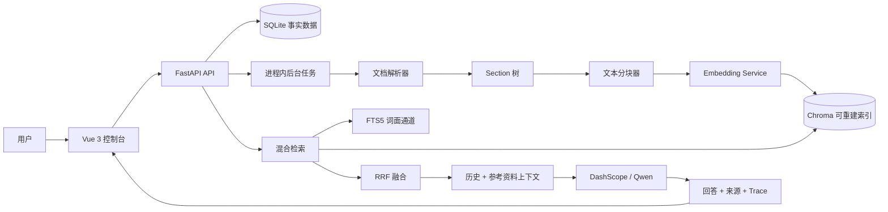

# KnowFlow 知汇

> 面向企业与个人的可追溯 RAG 知识库。把分散的资料变成可以检索、提问和复查来源的知识系统。

KnowFlow 是一个本地单用户的智能知识库问答应用，覆盖文档上传、结构化解析、文本分块、混合检索（词面 FTS + 语义向量 + RRF 融合）、通义千问生成、引用展示和检索过程追踪。它的重点不是“让模型自由聊天”，而是让回答尽量回到用户自己的资料。无论是企业的内部文档、团队知识沉淀，还是个人的学习笔记与收藏资料，都可以统一纳管、随时检索与追问。

## 当前状态

当前版本 `0.3.0`，已完成一轮 61 项问题的专业评估与全面优化（4 个修复批次 + 独立复核，详见 [评估报告](docs/项目评估报告-2026-10-12.md) 与 [优化执行报告](docs/优化执行报告-2026-10-12.md)），并经 [优化后复评](docs/项目评估报告-优化后-2026-10-12.md) 逐条核实落地：

- 三通道混合检索：SQLite FTS5 词面通道（中文双字分词 + LIKE 降级）与语义向量通道经 RRF（k=60）融合；检索通道（`vector`/`lexical`/`hybrid`）可在设置中切换，全过程有 trace；拒答阈值统一走 `threshold_score`（lexical-only 结果折减 0.5），消除跨通道阈值漂移。
- 使用 DashScope `text-embedding-v3` 进行语义 embedding；没有有效 API Key 时保留 deterministic hashing fallback，方便离线开发和测试；fallback 切换带 60 秒冷却与恢复探测，切换/恢复均记录告警日志，不再永久静默降级。
- 提示词注入防护：参考资料块带结构化定界符，`<source>`/`<user_question>` 标签形、`[资料 N]` 引用标记与「用户问题：」头均做转义，恶意文档无法伪造引用结构。
- 文档解析输出层级化 Section 模型（`document_section` 表），每个 chunk 归属一个 section 并携带 `section_path`，引用可回查到章节路径；docx 表格按原文位置插入。
- 多轮会话会把最近历史送入 LLM，并使用历史中的最近用户问题辅助指代消解；会话与用户消息先落库再调用 LLM，上游失败返回 502 且对话轮次保留。
- 每条回答返回引用片段、相似度分数、检索 trace 和 token 使用量；支持五种学习任务模式（question/explain/compare/summarize/exercise）与隐私模式（local/hybrid/cloud）。
- 上传采用分块落盘和大小限制，并立即返回 `202 processing`；解析、分块、embedding、Chroma 写入在进程内后台任务中完成，前端自动轮询最终状态，失败文档可以一键重试。
- SQLite 开启 WAL 与 `busy_timeout`；启动时自动恢复遗留 `processing` 文档，并对 Chroma 做孤儿向量对账回收（pytest 环境自动跳过以保护真实存储）。
- 7 个列表端点统一 `limit/offset` 分页（默认 100、上限 500）；`/api/admin/export` 改为流式 JSON 导出，内存峰值受批次约束。
- SQLite 是事实数据源，Chroma 是可重建索引；知识库级索引重建带防重入守卫与失败补偿；数据导出与确认清理齐备。
- 数据库结构变更由 `schema_migrations` 版本化迁移管理（幂等，覆盖全新库与旧库升级）。
- 后端 176 项 pytest、前端 47 项 Vitest、Ruff、mypy、覆盖率上报、Vite build 和依赖审计已接入 GitHub Actions（main 分支 CI 全绿）。

远端仓库：[LBStruggleee/KnowFlow](https://github.com/LBStruggleee/KnowFlow)
稳定版本以仓库 `main` 分支和对应 GitHub Actions 结果为准。

## 能做什么

### 知识库管理

- 创建、重命名和分类管理多个知识库。
- 上传 `.txt`、`.md`、`.pdf`、`.docx`、`.pptx` 文件。
- 自动提取正文和表格文本，按标题层级构建 Section 树，并按段落感知规则在 Section 内切分 chunk。
- 查看可观测的 `processing → finished/failed` 状态、内容预览、chunk 数、分块内容和 Section 树。
- 对解析或索引失败的文档重新提交后台处理，无需再次上传原文件。
- 下载已上传的原始文件（`GET /api/documents/{id}/file`）。
- 删除文档或知识库，并清理关联的会话、文件和向量。
- 在索引异常或切换 embedding 模型后重建知识库索引。

### RAG 问答与检索

- 三通道混合检索：FTS5 词面检索 + 语义向量检索 + RRF 融合，中文术语可被词面命中。
- 检索通道可在系统设置中切换（`vector` / `lexical` / `hybrid`，默认 `hybrid`）。
- 支持多轮上下文，历史窗口受消息数和字符数双重限制。
- 回答严格要求基于参考资料；资料中的指令会被视为不可信内容。
- 展示引用来源、chunk、分数、请求 Top K、返回数量和阈值判断。
- 支持五种学习任务模式：question、explain、compare、summarize、exercise。
- 隐私模式：`local`（纯本地抽取式回答，不外发）、`hybrid`（默认，仅命中片段外发）、`cloud`。
- 支持配置检索数量、分数阈值、Qwen 模型和生成温度。
- 独立检索接口 `POST /api/kbs/{kb_id}/search` 可直接执行混合检索。

### 学习沉淀与系统管理

- 学习记录（note / exercise / mistake）可从会话消息一键保存，也可手动创建，支持筛选、更新与删除。
- 系统状态面板：知识库、文档、会话、学习记录统计与累计 token 用量。
- Provider 状态：LLM 与 embedding 可用性一览。
- 数据导出：`GET /api/admin/export` 以流式 JSON 导出全部事实数据。
- 数据清理：`DELETE /api/admin/data?confirmation=DELETE` 二次确认后清空事实数据与索引。

### 工程能力

- 结构化服务端日志和失败堆栈。
- 上传大小限制、外部 API 超时、输入 trim 和路径安全检查。
- SQLite 外键约束与事务处理；连接级开启 WAL 与 `busy_timeout`；Chroma 外部资源失败时有补偿清理，启动时孤儿向量对账回收。
- 启动时自动恢复遗留 `processing` 文档，并通过 `schema_migrations` 执行版本化迁移与 FTS 回填。
- 数据库结构变更版本化管理，幂等迁移覆盖全新库与旧库升级。
- GitHub Actions 自动执行后端/前端测试、Ruff 检查、mypy 类型检查、覆盖率上报、构建和依赖审计。

## 架构



设计上的数据边界：SQLite 保存知识库、文档、Section、chunk、FTS 索引、会话、消息和学习记录；Chroma 只保存可通过 SQLite chunk 重建的向量索引。删除、模型切换或索引异常时，优先保证 SQLite 事实数据，再清理或重建外部资源。

## 技术栈

| 层 | 技术 |
| --- | --- |
| 前端 | Vue 3、Vite、Element Plus、Axios、Markdown It |
| 后端 | FastAPI、SQLAlchemy、Pydantic |
| 元数据 | SQLite（含 FTS5 词面索引） |
| 向量索引 | Chroma PersistentClient |
| LLM / Embedding | DashScope OpenAI-compatible API、Qwen、`text-embedding-v3` |
| 文档解析 | pypdf、python-docx、python-pptx、TXT/Markdown reader |
| 测试 | pytest、Vitest |
| 工程检查 | Ruff、pip-audit、npm audit、GitHub Actions |

## 项目结构

```text
KnowFlow/
├── backend/
│   ├── app/
│   │   ├── api/             # REST API：health、知识库、文档、混合检索、聊天、会话、学习记录、admin
│   │   ├── core/            # 配置、数据库、迁移、分页和通用工具
│   │   ├── models/          # SQLAlchemy 数据模型（含 DocumentSection、LearningRecord、SystemSetting）
│   │   ├── schemas/         # Pydantic 输入/输出模型
│   │   └── services/        # parser、chunker、lexical/hybrid/vector 检索、RAG、LLM、设置、启动恢复
│   ├── tests/               # 单元测试和 API 集成测试（21 个测试文件，176 项）
│   ├── storage/             # 本地上传文件和 Chroma 数据，已被 gitignore
│   ├── pyproject.toml       # 后端项目元数据与工具配置（pytest/mypy/coverage）
│   ├── requirements.txt     # 运行依赖
│   └── requirements-dev.txt # 测试、lint、类型检查和审计工具
├── frontend/
│   ├── src/
│   │   ├── api/             # Axios API client 及其测试
│   │   ├── demo/            # Liquid Glass 工作台：DemoApp、4 个视图、composables、纯函数、样式
│   │   ├── assets/          # 静态资源
│   │   └── main.js          # 应用入口（Element Plus 按需引入）
│   ├── eslint.config.js     # ESLint 配置
│   └── package.json
├── docs/                    # 技术方案、系统 UML 图、设计文档、评估报告与 superpowers 设计 spec
├── Dockerfile               # 后端镜像（python:3.13-slim，托管 frontend/dist 同源部署）
├── docker-compose.yml       # 本地部署（绑定 127.0.0.1，数据/密钥卷挂载）
├── CHANGELOG.md             # 版本演进概述
├── .pre-commit-config.yaml  # ruff check/format 钩子
├── .github/workflows/ci.yml # GitHub Actions
└── README.md
```

## 快速启动

### 1. 后端

需要 Python 3.13。

```powershell
cd D:\KnowFlow\backend
python -m venv .venv
.\.venv\Scripts\Activate.ps1
pip install -r requirements.txt
Copy-Item .env.example .env
```

编辑 `backend/.env`：

```env
DASHSCOPE_API_KEY=your_dashscope_api_key
EMBEDDING_PROVIDER=dashscope
EMBEDDING_MODEL=text-embedding-v3
EMBEDDING_BATCH_SIZE=10
QWEN_BASE_URL=https://dashscope.aliyuncs.com/compatible-mode/v1
QWEN_MODEL=qwen-plus
LLM_TIMEOUT_SECONDS=60
HISTORY_MAX_MESSAGES=20
HISTORY_MAX_CHARS=16000
UPLOAD_MAX_BYTES=52428800
CORS_ORIGINS=http://127.0.0.1:5173,http://localhost:5173
```

启动 API：

```powershell
uvicorn app.main:app --reload --host 127.0.0.1 --port 8000
```

检查服务：

- Health：<http://127.0.0.1:8000/api/health>
- Swagger：<http://127.0.0.1:8000/docs>

没有有效 `DASHSCOPE_API_KEY` 时，embedding 会自动降级到本地 hashing 实现；隐私模式为 `local` 或 LLM Key 无效时，回答退化为本地抽取式结果，但真实生成仍需要配置 LLM API Key。

### 2. 前端

```powershell
cd D:\KnowFlow\frontend
npm install
npm run dev -- --host 127.0.0.1 --port 5173
```

打开 <http://127.0.0.1:5173/>。

#### 开发代理与同源部署

- **开发模式**：`frontend/.env.example` 默认注释掉 `VITE_API_BASE`，即默认同源；此时 Vite dev server（与 `npm run preview`）会把 `/api` 请求代理到 `http://127.0.0.1:8000`（见 `frontend/vite.config.js` 的 `server.proxy` 与 `preview.proxy`）。若要直连其他后端地址，取消注释 `VITE_API_BASE=http://127.0.0.1:8000`。
- **生产同源部署**：先 `npm run build` 生成 `frontend/dist`，再正常启动后端即可。后端在 `create_app()` 末尾检测到 `frontend/dist` 目录存在时，会把它以 `StaticFiles(html=True)` 挂载在 `/`，API 与 UI 共享同一来源，无需任何 CORS 配置；`/` 上的所有 API 路由（以及 `/docs`）优先于静态回退。
- **跨源部署（可选）**：若前后端分开部署，请把前端来源加入 `backend/.env` 的 `CORS_ORIGINS`。

### 3. Docker 部署（可选）

提供 `Dockerfile` 与 `docker-compose.yml`，仅面向本地使用：

```powershell
# 先构建前端静态资源（后端容器会托管 dist，实现同源）
cd frontend && npm install && npm run build && cd ..

docker compose up --build
```

- 应用监听容器内 `8000` 端口，compose 仅绑定 `127.0.0.1:8000`，不映射到公网。
- 三个卷保证数据持久化与密钥安全：`backend/data`（SQLite）、`backend/storage`（上传文件 + Chroma）、`backend/.env`（只读挂载 API Key）。
- 该部署为本地单用户形态：无认证、无限流，切勿把 `127.0.0.1:8000` 端口转发或暴露到公网。

## 质量检查

安装开发依赖：

```powershell
cd D:\KnowFlow\backend
.\.venv\Scripts\Activate.ps1
pip install -r requirements-dev.txt
$env:PYTHONPATH = "."
pytest tests -q
ruff check app
ruff format --check app
mypy
pip-audit -r requirements.txt --ignore-vuln PYSEC-2026-311 --ignore-vuln PYSEC-2026-3813 --ignore-vuln PYSEC-2026-3814 --ignore-vuln PYSEC-2026-3815
```

执行前端检查：

```powershell
cd D:\KnowFlow\frontend
npm test
npm run lint
npm run build
npm audit --audit-level=high
```

GitHub Actions 会在 push 和 pull request 时执行同类检查。当前验证基线为后端 176 项 pytest、前端 47 项 Vitest 测试全部通过。

## 主要 API

以下为 `backend/app/main.py` 当前注册的全部 32 个业务端点（不含 `/docs`、`/openapi.json` 等 FastAPI 自带路由）：

| 方法 | 路径 | 作用 | 关键状态码 |
| --- | --- | --- | --- |
| `GET` | `/api/health` | 服务、embedding provider 和 collection 健康信息 | 200 |
| `GET` | `/api/kbs` | 知识库列表 | 200 |
| `POST` | `/api/kbs` | 创建知识库 | 201；同名 409 |
| `GET` | `/api/kbs/{kb_id}` | 知识库详情 | 200；不存在 404 |
| `PATCH` | `/api/kbs/{kb_id}` | 重命名/改分类 | 200；同名 409 |
| `DELETE` | `/api/kbs/{kb_id}` | 删除知识库及关联数据 | 204 |
| `POST` | `/api/kbs/{kb_id}/rebuild-index` | 重新解析 finished 文档并重建 section 与 Chroma 索引（源文件缺失则仅重嵌） | 202；文档处理中/为空 409；上游失败 502 |
| `POST` | `/api/kbs/{kb_id}/search` | 直接执行混合检索（通道由 `retrieval_channels` 设置决定） | 200 |
| `POST` | `/api/kbs/{kb_id}/documents/upload` | 上传文档并提交后台处理 | 202 processing；类型 400、超限 413、空文件 400 |
| `GET` | `/api/kbs/{kb_id}/documents` | 知识库文档列表（分页，含 chunk 数） | 200 |
| `GET` | `/api/documents/{document_id}` | 单个文档最新处理状态 | 200；404 |
| `GET` | `/api/documents/{document_id}/file` | 下载原始上传文件 | 200；404 |
| `DELETE` | `/api/documents/{document_id}` | 删除文档及其向量、Section 和文件 | 204 |
| `POST` | `/api/documents/{document_id}/retry` | 重新处理 `failed` 文档 | 202；非 failed 409 |
| `GET` | `/api/documents/{document_id}/chunks` | 文档分块列表（分页，含 section_path） | 200 |
| `GET` | `/api/documents/{document_id}/sections` | 文档 Section 树（分页作用于扁平前序列表） | 200 |
| `POST` | `/api/chat` | 执行带历史上下文与任务模式的混合检索 RAG 问答 | 200；上游失败 502 |
| `POST` | `/api/conversations` | 创建会话 | 201 |
| `GET` | `/api/conversations` | 会话列表 | 200 |
| `GET` | `/api/conversations/{conversation_id}` | 会话详情（含消息与引用） | 200；404 |
| `DELETE` | `/api/conversations/{conversation_id}` | 删除会话 | 204 |
| `POST` | `/api/learning-records` | 创建学习记录（note/exercise/mistake） | 201；类型 422、外链不存在 404 |
| `GET` | `/api/learning-records` | 学习记录列表（可按类型筛选） | 200 |
| `GET` | `/api/learning-records/{record_id}` | 学习记录详情 | 200；404 |
| `PATCH` | `/api/learning-records/{record_id}` | 更新学习记录 | 200；404 |
| `DELETE` | `/api/learning-records/{record_id}` | 删除学习记录 | 204 |
| `GET` | `/api/admin/settings` | 读取检索与生成参数（含 `retrieval_channels`） | 200 |
| `PATCH` | `/api/admin/settings` | 更新检索与生成参数 | 200 |
| `GET` | `/api/admin/providers` | LLM/embedding Provider 与索引状态 | 200 |
| `GET` | `/api/admin/status` | 系统统计与 token 用量 | 200 |
| `GET` | `/api/admin/export` | 流式导出全部事实数据（`knowflow-export.json`） | 200 |
| `DELETE` | `/api/admin/data` | 二次确认后清空事实数据与索引 | 200；确认词错误 400 |

问答示例：

```http
POST /api/chat
Content-Type: application/json

{
  "kb_id": 1,
  "question": "RAG 的核心流程是什么？",
  "conversation_id": null,
  "mode": "question"
}
```

混合检索示例：

```http
POST /api/kbs/1/search
Content-Type: application/json

{
  "query": "文本分块有什么作用？",
  "top_k": 3
}
```

## Embedding 与索引迁移

embedding 模型或 provider 会参与 Chroma collection 命名。切换模型后，旧 collection 不会被错误复用；需要对每个知识库执行：

```http
POST /api/kbs/{kb_id}/rebuild-index
```

重建过程会从 SQLite 中现有的 `DocumentChunk` 重新生成向量。上传资料不会因为 Chroma 索引损坏而丢失，但索引清理失败时应查看服务端日志并执行重建。

## 安全与部署边界

当前项目是本地单用户应用：

- 默认后端只监听 `127.0.0.1`；Docker compose 也只绑定 `127.0.0.1`。
- 当前没有用户认证、授权和限流。
- 不要把后端或 Chroma 数据目录直接暴露到公网。
- API Key 只放在 `backend/.env`，不要提交到 Git。
- `UPLOAD_MAX_BYTES` 默认 50 MiB；解析器和上传处理仍应在受控环境运行。
- 当前后台任务由 FastAPI 进程内执行，适合本地单实例；它没有跨进程持久队列、任务租约和分布式重试能力，进程被强制终止时应删除并重新上传停留在 `processing` 的文档。

若要用于公网或多用户场景，必须先补充认证/授权、租户隔离、限流、持久任务队列、数据库迁移和审计日志。

## 文档与路线图

- [系统 UML 图](docs/系统UML图.md)：整体用例、领域模型与交互流程。
- [技术方案](docs/技术方案.md)：架构设计与关键技术说明。
- [CHANGELOG](CHANGELOG.md)：版本演进概述。
- [专业评估报告](docs/项目评估报告-2026-10-12.md)：优化前 61 项问题的三分类评估基线。
- [优化执行报告](docs/优化执行报告-2026-10-12.md)：7 个修复批次的执行记录与门禁。
- [优化后复评报告](docs/项目评估报告-优化后-2026-10-12.md)：优化落地的逐条核实与残留问题清单。

下一阶段：

1. SSE 流式回答、请求取消和有限重试。
2. 补齐测试工程：Vue 组件挂载测试设施、覆盖率阈值门禁、测试与真实存储的完全隔离、kbs/conversations/admin 等端点分支测试。
3. 用持久任务队列替换当前进程内后台任务，并增加任务租约、心跳、自动恢复和并发控制。
4. 用户认证授权和知识库权限（多用户场景前置条件）。
5. 建立 Recall@K、MRR、拒答准确率和同义改写稳定性的 RAG 评测集。

## License

KnowFlow 采用 [MIT License](LICENSE) 开源。参与贡献前请阅读
[CONTRIBUTING.md](CONTRIBUTING.md)；安全问题请按照
[SECURITY.md](SECURITY.md) 私下报告。
