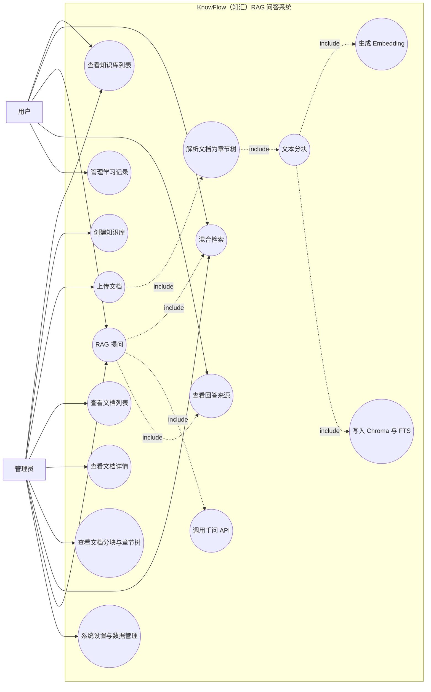
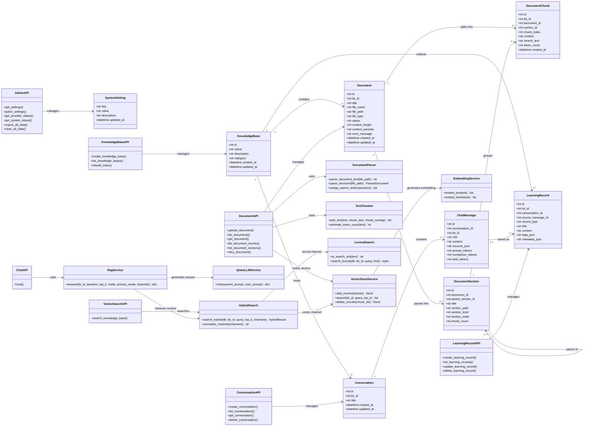
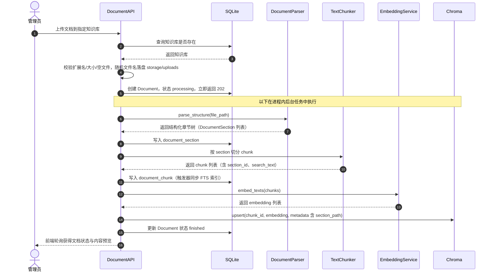
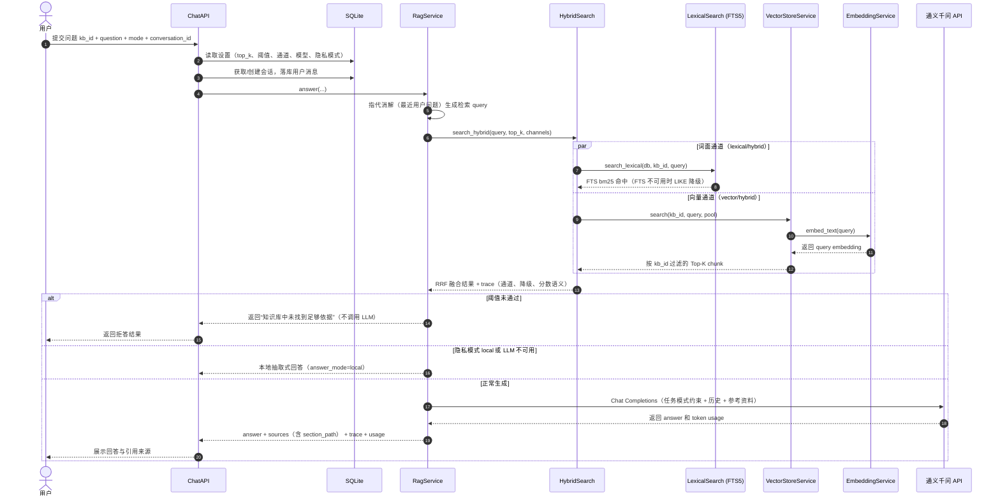
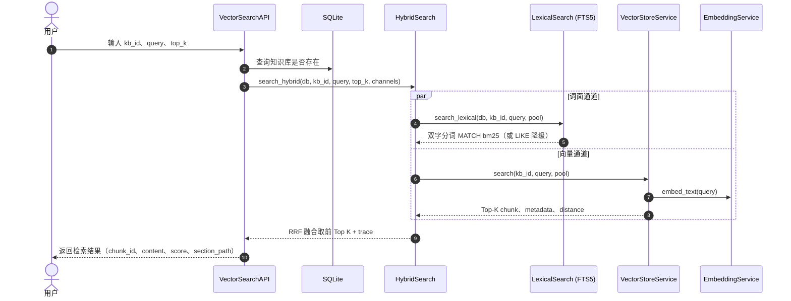

# KnowFlow（知汇）系统 UML 图

> 最后更新：2026-10-12（与 v0.3.0 代码同步：层级化 Section 模型、三通道混合检索、学习记录与 admin API）

本文档基于当前 KnowFlow 后端实现绘制，覆盖知识库管理、文档上传解析、层级化分块、向量化入库、三通道混合检索（FTS5 词面 + 语义向量 + RRF 融合）和 RAG 问答流程。

## 1. 用例图



### 用例说明

| 参与者 | 主要用例 | 说明 |
| --- | --- | --- |
| 用户 | 查看知识库、混合检索、RAG 提问、查看回答来源、管理学习记录 | 面向学习者与资料使用者，核心行为是选择知识库并提问 |
| 管理员 | 创建知识库、上传文档、查看分块与章节、系统设置与数据管理 | 负责维护知识库和资料入库 |
| 系统内部 | 解析文档、文本分块、生成 Embedding、写入 Chroma 与 FTS、调用千问 API | 属于自动执行的内部流程 |

## 2. 类图



### 类图说明

| 类/模块 | 作用 |
| --- | --- |
| `KnowledgeBase` | 知识库实体，统一纳管企业文档、团队沉淀或个人资料 |
| `Document` | 文档实体，记录上传文件、解析状态和内容预览 |
| `DocumentSection` | 层级化章节实体，构成文档章节树，`section_path` 用于引用回查 |
| `DocumentChunk` | 文档分块实体，是检索的基本单位；`search_text` 为双字化检索列，供 FTS 使用 |
| `Conversation` / `ChatMessage` | 多轮会话与消息，`sources_json` 持久化引用快照，token 用量入库 |
| `LearningRecord` | 学习记录（note / exercise / mistake），可关联来源会话与消息 |
| `SystemSetting` | 键值系统设置（检索通道、Top K、阈值、模型、隐私模式等） |
| `DocumentParser` | 文档解析服务，支持 `.txt`、`.md`、`.pdf`、`.docx`、`.pptx`，并输出结构化章节树 |
| `TextChunker` | 文本分块服务，按 section 独立切分 chunk 并估算 token |
| `EmbeddingService` | 向量生成服务：DashScope `text-embedding-v3` 语义 embedding；无有效 API Key 时降级为本地 deterministic hashing embedding（离线开发与测试用），降级路径不影响在线语义检索的默认行为 |
| `LexicalSearch` | 词面检索通道：中文重叠双字分词 + SQLite FTS5（bm25），FTS 不可用时降级 LIKE |
| `HybridSearch` | 混合检索编排：向量 + 词面双通道 RRF（k=60）融合，通道可配、过程可 trace |
| `VectorStoreService` | Chroma 向量库服务，负责向量写入和相似度检索 |
| `QwenLLMService` | 千问模型调用服务，封装 DashScope OpenAI 兼容接口 |
| `RagService` | RAG 编排服务：混合检索、构造 Prompt（含任务模式与历史）、调用 LLM、拒答与本地降级 |

## 3. 文档入库顺序图



### 文档入库流程说明

该流程对应接口：

```text
POST /api/kbs/{kb_id}/documents/upload
```

核心结果：

```text
文档被保存到本地 storage/uploads
解析结果构建为 document_section 章节树
正文按 section 切分为 document_chunk（携带 section_path 与 search_text）
每个 chunk 被生成 embedding，向量与 metadata 写入 Chroma
FTS 索引由 SQLite 触发器自动同步
Document 状态变为 finished；失败时回滚并标记 failed，可重试
```

## 4. RAG 问答顺序图（混合检索）



### RAG 问答流程说明

该流程对应接口：

```text
POST /api/chat
```

请求示例：

```json
{
  "kb_id": 1,
  "question": "文本分块有什么作用？",
  "top_k": 5,
  "mode": "question",
  "conversation_id": null
}
```

返回结果包含：

```text
answer：千问基于检索上下文生成的回答（或本地抽取式回答）
answer_mode：local / cloud；provider：实际使用的模型或本地实现
sources：被检索到的 chunk 来源（含 section_path 章节路径）
retrieval_trace：混合检索通道、RRF 融合、Top K、阈值与最高分
usage：LLM API 返回的 token 使用量
```

## 5. 混合检索顺序图



该流程对应接口：

```text
POST /api/kbs/{kb_id}/search
```

通道由系统设置 `retrieval_channels`（`vector` / `lexical` / `hybrid`，默认 `hybrid`）决定；该接口主要用于验证索引入库是否成功，也可以作为 RAG 问答前的调试工具。

## 6. 管理与学习沉淀 API

当前实现已覆盖以下管理与学习沉淀端点：

```text
GET/PATCH /api/admin/settings        检索通道、Top K、阈值、模型与隐私设置
GET /api/admin/providers             LLM/embedding Provider 与索引状态
GET /api/admin/status                系统统计与 token 用量
GET /api/admin/export                流式导出全部事实数据
DELETE /api/admin/data               二次确认后清理事实数据与索引
GET/POST /api/conversations          会话列表/创建
GET/DELETE /api/conversations/{id}   会话详情/删除
GET/POST /api/learning-records       学习记录列表/创建（note/exercise/mistake）
GET/PATCH/DELETE /api/learning-records/{id}  学习记录详情/更新/删除
```
